# Building the GPU Compute Foundation for an Atmosphere Renderer in Godot 4.5

Before the atmosphere can scatter a single photon, there is a much less glamorous problem to solve:

**where does the computation actually happen?**

The later parts of this series deal with Rayleigh scattering, Mie scattering, ozone absorption, transmittance, multiple scattering, sky-view radiance, clouds, and aerial perspective.

None of them can exist in this implementation without a reliable way to:

- load compute shaders,
- create GPU textures,
- upload parameters,
- bind resources,
- dispatch work,
- expose the resulting textures back to Godot,
- and clean everything up without leaking GPU resources.

That is what this part builds.

This is the rendering infrastructure underneath the atmosphere system.

And there is one architectural decision that is worth making explicit **before** going any further:

> **This renderer is built around Godot's Forward+ / Vulkan rendering path and uses compute shaders for runtime LUT generation.**

That decision has consequences.

The Compatibility renderer does not provide the compute-shader path used by this implementation. As a result, the runtime LUT architecture described throughout this series is not intended to be a universal renderer abstraction for every Godot backend.

That is a constraint I want documented here rather than discovered several parts later.

There is another perfectly reasonable architecture: precompute the expensive LUTs offline, ship them as textures, and keep only the genuinely dynamic work at runtime. That approach gives up some of the renderer's runtime flexibility in exchange for broader compatibility.

This project deliberately takes the other route.

The atmosphere is meant to be a **runtime system**, with parameters that can drive the precomputed state and eventually interact with weather, celestial state, clouds, and planetary mode. Runtime compute therefore becomes part of the architecture rather than an implementation detail.

The rest of this post is about building that foundation.

---

## The Problem We're Actually Solving

The atmosphere renderer eventually needs several GPU-generated resources:

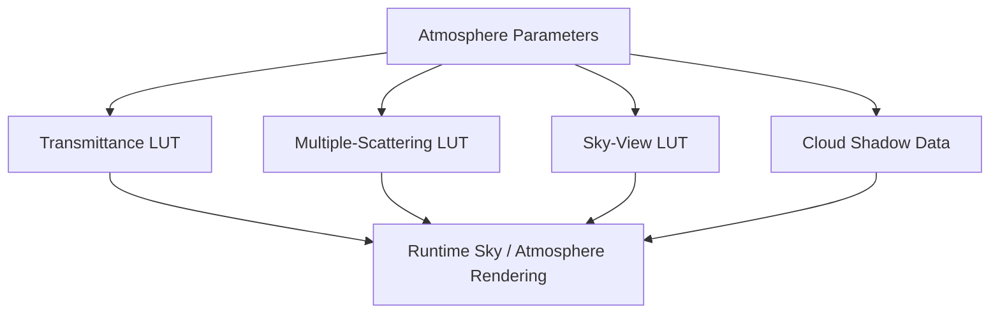

Every one of those resources follows roughly the same mechanical process:

```text
load shader
    ↓
create GPU resource
    ↓
upload parameters
    ↓
bind resources
    ↓
dispatch compute
    ↓
consume generated texture
```

The atmospheric mathematics is different for each pass.

The GPU plumbing is not.

That distinction is important.

If every LUT owns its own collection of raw `RenderingDevice` calls, the project quickly becomes a collection of subtly different resource-management implementations.

One class creates textures one way.

Another builds uniform buffers slightly differently.

Another forgets to free a uniform set.

Another calculates dispatch dimensions incorrectly for non-power-of-two textures.

Another reports shader errors differently.

The mathematics might be correct while the renderer becomes increasingly difficult to reason about.

So the goal here is to build the machinery **once** and make the atmospheric passes consume it.

---

## The Renderer Boundary

There are effectively two worlds involved here.

On one side is Godot's normal rendering architecture:

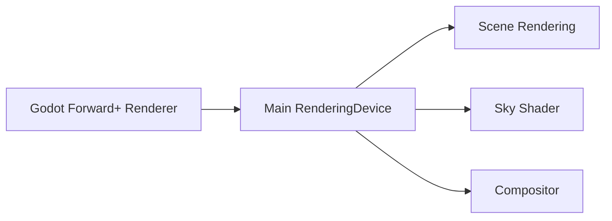

On the other side is the custom compute infrastructure:

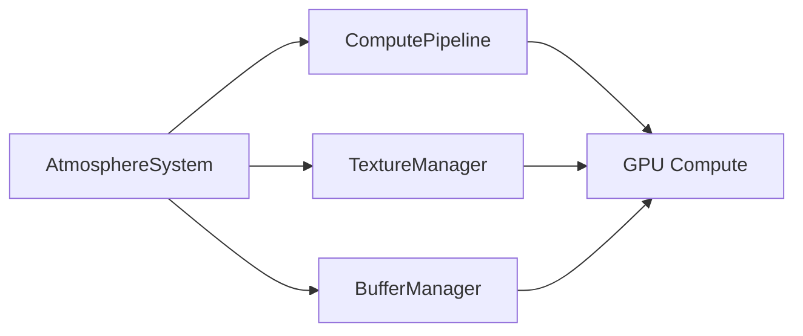

The infrastructure exists between those worlds.

The important requirement is that a generated LUT cannot merely exist on the GPU.

It needs to become a resource that **Godot's renderer can consume**.

That requirement is what makes the distinction between Godot's rendering devices so important.

---

## Two RenderingDevices, Two Different Jobs

One of the first architectural discoveries in this implementation was that Godot 4.5 exposes two fundamentally different `RenderingDevice` contexts.

They are useful for different reasons.

### The Main RenderingDevice

The main device is obtained through:

```gdscript
var rd := RenderingServer.get_rendering_device()
```

This is the device used by the running renderer.

Resources created here live in the same GPU context as the Forward+ renderer. That means textures created through it can ultimately be exposed through `Texture2DRD` and consumed by the rest of the rendering pipeline.

This is the **production path**.

But it has an important limitation:

```text
main device
    └── submission is owned by Godot
```

You do not manually call `submit()` or `sync()` on this device.

Godot records the work and handles submission as part of its renderer lifecycle.

That is exactly what we want for a production renderer, but it makes synchronous GPU readback unsuitable as the primary validation mechanism.

---

### The Local RenderingDevice

A local device is created with:

```gdscript
var rd := RenderingServer.create_local_rendering_device()
```

This creates a separate rendering context.

It supports explicit:

```text
submit()
sync()
buffer_get_data()
```

which makes it extremely useful for deterministic testing.

The important catch is:

> A local device is not the main renderer's device.

A texture created on the local device is not automatically visible to the Forward+ renderer.

This means a local texture cannot simply be wrapped in `Texture2DRD` and expected to appear in the game's sky.

The relationship is therefore:

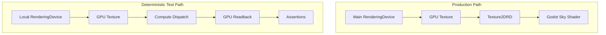

The same infrastructure classes should work with both.

The device changes.

The abstraction does not.

---

## Why Not Just Use One Device?

Because the two use cases are fundamentally different.

The renderer needs:

```text
main device
→ shared GPU context
→ renderer-visible textures
→ asynchronous frame execution
```

The tests need:

```text
local device
→ explicit submission
→ synchronization
→ deterministic readback
→ numerical assertions
```

Trying to force one path to perform both jobs makes the architecture worse.

The final infrastructure therefore treats the `RenderingDevice` as a dependency rather than a singleton hidden inside every class.

Conceptually:

```gdscript
var texture_manager := TextureManager.new()
texture_manager.initialize(rd)
```

The manager does not need to know whether `rd` came from:

```gdscript
RenderingServer.get_rendering_device()
```

or:

```gdscript
RenderingServer.create_local_rendering_device()
```

That makes the same resource-management code usable in both production and testing.

---

## The Compute Pipeline

Godot's compute shader path has a useful separation between the shader source and the actual GPU pipeline.

The source begins as GLSL:

```glsl
#[compute]
#version 450

layout(local_size_x = 8, local_size_y = 8, local_size_z = 1) in;
```

Godot imports that shader and produces an `RDShaderFile`.

At runtime, the infrastructure follows this path:

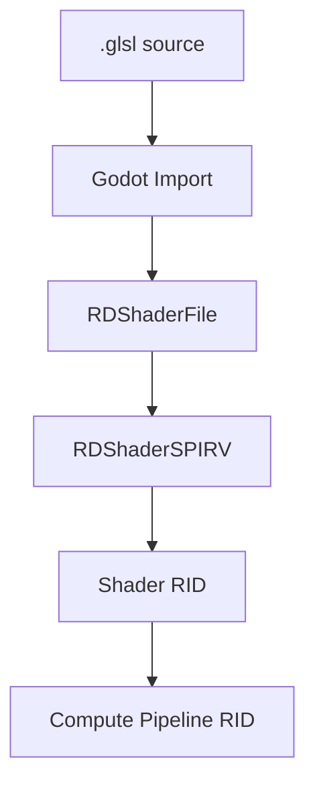

The important part is that runtime code does not need to implement its own GLSL-to-SPIR-V compiler.

The imported resource already contains the shader's SPIR-V representation.

The `ComputePipeline` abstraction therefore has three main responsibilities:

1. Load the imported shader resource.
2. Validate the SPIR-V and stage errors.
3. Create and own the compute pipeline.

A useful failure should tell us **which shader failed and why**.

For example:

```gdscript
var compute_error: String = spirv.get_stage_compile_error(
    RenderingDevice.SHADER_STAGE_COMPUTE
)

if compute_error != "":
    push_error(
        "AtmosphereSystem: compute shader '%s' compile error:\n%s"
        % [shader_path, compute_error]
    )
    return false
```

That may look like ordinary error handling.

In rendering infrastructure, it is essential.

A black texture is not a useful error message.

---

## The Smallest Possible Compute Test

Before implementing atmospheric mathematics, the infrastructure needs a test that is almost insultingly simple.

That is intentional.

The smoke-test shader writes a gradient:

```glsl
#[compute]
#version 450

layout(local_size_x = 8, local_size_y = 8, local_size_z = 1) in;

layout(set = 0, binding = 0, rgba8) uniform writeonly image2D output_image;

layout(set = 0, binding = 1, std140) uniform Params {
    float width;
    float height;
    float _pad0;
    float _pad1;
} params;

void main() {
    ivec2 pixel = ivec2(gl_GlobalInvocationID.xy);

    int w = int(params.width);
    int h = int(params.height);

    if (pixel.x >= w || pixel.y >= h) {
        return;
    }

    float u = float(pixel.x) / float(w);
    float v = float(pixel.y) / float(h);

    vec4 color = vec4(u, v, 0.5, 1.0);

    imageStore(output_image, pixel, color);
}
```

There is no atmosphere here.

No scattering.

No ray marching.

No matrices.

No physical constants.

Just:

```text
pixel position
    ↓
normalised coordinates
    ↓
imageStore()
```

That makes the test valuable.

If the output is wrong, there are very few places for the problem to hide.

---

## Dispatching the Work

Godot's `RenderingDevice` uses command recording rather than immediate GPU execution.

The basic pattern is:

```gdscript
var compute_list := rd.compute_list_begin()

rd.compute_list_bind_compute_pipeline(
    compute_list,
    pipeline_rid
)

rd.compute_list_bind_uniform_set(
    compute_list,
    uniform_set_rid,
    0
)

rd.compute_list_dispatch(
    compute_list,
    groups_x,
    groups_y,
    groups_z
)

rd.compute_list_end()
```

The GPU does not execute the shader simply because `compute_list_dispatch()` was called.

The command has been recorded.

On a local device, the test can then explicitly submit and synchronize.

On the main device, Godot owns the submission lifecycle.

That distinction is hidden from the atmospheric LUT implementations by the infrastructure layer.

---

## Workgroup Calculation

Compute shaders operate in workgroups rather than directly in texture dimensions.

For an 8 × 8 local workgroup:

```text
texture: 64 × 64
workgroup: 8 × 8

groups:
64 / 8 = 8
64 / 8 = 8

dispatch:
8 × 8
```

But real LUT dimensions are not always exact multiples of the local size.

For example:

```text
texture: 100 × 50
workgroup: 8 × 8

groups:
ceil(100 / 8) = 13
ceil(50 / 8)  = 7

dispatch:
13 × 7
```

The infrastructure therefore centralizes this calculation:

```gdscript
static func calculate_groups_2d(
    width: int,
    height: int,
    local_size_x: int,
    local_size_y: int
) -> Vector2i:
    return Vector2i(
        ceili(float(width) / float(local_size_x)),
        ceili(float(height) / float(local_size_y))
    )
```

This is a tiny function.

It is also exactly the sort of tiny function that should not be independently reimplemented by every LUT.

---

## The Texture Manager

The compute pipeline needs somewhere to write its output.

That is the job of the texture manager.

At the infrastructure level, the manager handles things such as:

- texture creation,
- format selection,
- usage flags,
- RID tracking,
- validity checks,
- `Texture2DRD` wrapping where appropriate,
- and cleanup.

The ownership relationship is deliberately explicit:

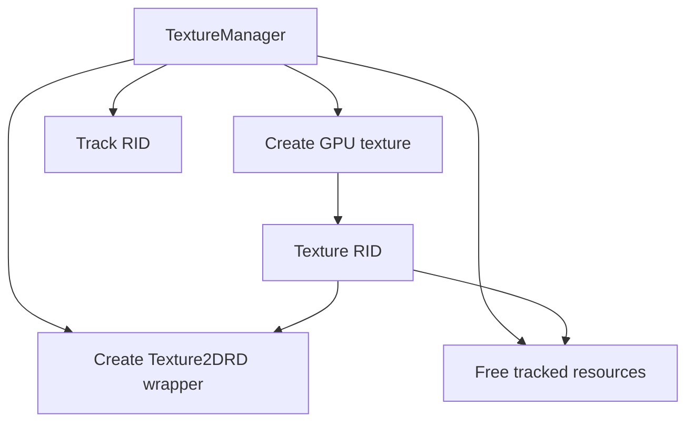

The manager owns the resource it creates.

That sounds obvious.

With GPU resources, it is not.

---

## GPU Resource Ownership

Godot's GPU resources are represented by opaque `RID` handles.

The handle itself does not communicate:

```text
who created me?
who is using me?
who replaces me?
who frees me?
```

The code has to establish those relationships.

The development rule for the renderer is therefore simple:

> **Every GPU resource must have an obvious owner.**

For example:

```gdscript
var tex_mgr := TextureManager.new()
tex_mgr.initialize(rd)

var rid := tex_mgr.create_compute_texture(256, 256)

# ... use texture ...

tex_mgr.free_all()
```

The manager tracks every RID it creates.

Cleanup is centralized.

Cleanup is also designed to be idempotent.

Calling cleanup twice should not turn an error path into a crash.

This becomes increasingly important later when LUT regeneration, editor reloads, scene teardown, and renderer shutdown all begin interacting with the same GPU resources.

---

## The Texture2DRD Trap

The separation between main and local devices becomes particularly important when `Texture2DRD` enters the picture.

The first smoke test attempted to do something that looked perfectly reasonable:

```text
local RenderingDevice
        ↓
compute texture
        ↓
compute dispatch
        ↓
read back pixels
        ↓
Texture2DRD
```

The final step failed.

The reason was not the texture itself.

`Texture2DRD.texture_rd_rid` validates the RID against the global RenderingDevice used by the renderer.

A texture created on a local RenderingDevice belongs to another Vulkan context.

The main renderer therefore cannot treat it as one of its textures.

The error looked roughly like:

```text
Condition "!RD::get_singleton()->texture_is_valid(p_texture_rd_rid)" is true
```

This forced the testing architecture to become more explicit.

The test now verifies two separate properties:

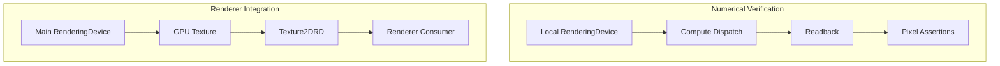

The local path answers:

> **Did the compute shader produce the expected data?**

The main-device path answers:

> **Can this resource actually enter Godot's rendering pipeline?**

Those are different questions.

Testing them separately makes both easier to reason about.

---

## A Note About Barriers

Coming from lower-level Vulkan work, one of the first questions is naturally:

**Where are the barriers?**

Godot 4.5's `RenderingDevice` handles a significant amount of this synchronization internally.

The older `barrier()` and `full_barrier()` APIs are deprecated no-ops because resource transitions are automatically handled by the RenderingDevice.

There is still:

```gdscript
rd.compute_list_add_barrier(compute_list)
```

for inserting a barrier between compute operations inside a compute list when multiple dispatches share resources.

The practical result for this infrastructure is that the LUT implementations do not need to become miniature Vulkan synchronization engines.

That is a good thing.

The abstraction should expose synchronization where the renderer actually needs control, without forcing every pass to manually reproduce backend resource-state management.

---

## Uniform Buffers and `std140`

The compute shader needs parameters.

Even the trivial smoke test needs:

```text
width
height
```

The atmospheric shaders will eventually need much more:

```text
planet radius
atmosphere radius
scale heights
scattering coefficients
camera state
celestial state
LUT dimensions
runtime controls
```

The interface between GDScript and GLSL therefore becomes critical.

The shader might declare:

```glsl
layout(set = 0, binding = 1, std140) uniform Params {
    float width;
    float height;
    float _pad0;
    float _pad1;
} params;
```

The CPU must produce bytes matching that layout.

This is where `std140` becomes relevant.

A `vec3` is not simply three tightly packed floats in the uniform-buffer layout.

It has 16-byte alignment requirements.

That means the CPU-side packing needs to understand the shader's memory layout rather than simply append values in conceptual order.

For example:

```gdscript
var data := PackedFloat32Array()

data.append(width)
data.append(height)
data.append(0.0)
data.append(0.0)
```

The four floats form a 16-byte block.

As the atmospheric parameter structures grow, explicit offset tracking becomes useful because a single alignment mistake can shift every field after it.

The shader does not know that the CPU made a mistake.

It simply reads the bytes it was given.

---

## Why the Infrastructure Uses Buffers Instead of Hiding Everything

The temptation when building an abstraction like this is to make it so high-level that the GPU disappears.

That would defeat the purpose of this project.

The infrastructure hides repetitive resource-management mechanics.

It does **not** hide the rendering model.

A LUT implementation should still make it obvious that it is doing:

```text
GPU texture
+
uniform buffer
+
uniform set
+
compute pipeline
+
dispatch
```

That makes the renderer easier to inspect when something goes wrong.

The abstraction is there to prevent duplication, not to make the GPU invisible.

---

## The Smoke Test

The smoke test uses a 64 × 64 RGBA8 texture.

The shader produces:

```text
R = horizontal position
G = vertical position
B = 0.5
A = 1.0
```

That gives us known pixels:

| Pixel | Expected RGBA | Meaning |
|---|---|---|
| `(0, 0)` | `(0, 0, 127, 255)` | top-left |
| `(63, 0)` | `(255, 0, 127, 255)` | top-right |
| `(0, 63)` | `(0, 255, 127, 255)` | bottom-left |

The exact values are less important than the fact that they are predictable.

The test therefore verifies several things at once:

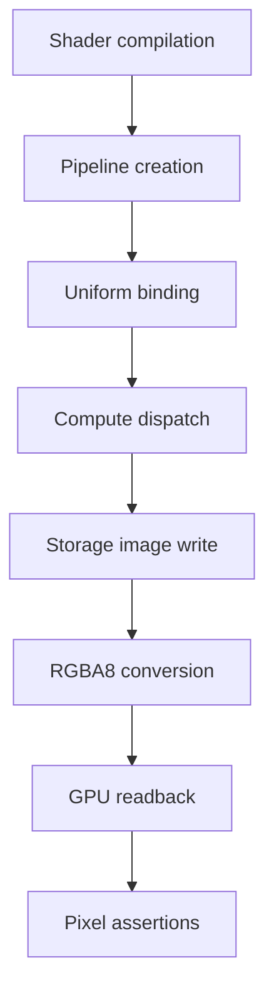

If the final pixel is wrong, we have a constrained debugging problem.

That is exactly what a smoke test should provide.

---

## Why the Test Uses a Boring Shader

This deserves emphasis because it is an easy principle to lose when building rendering systems.

A smoke test should not be impressive.

It should be **diagnostic**.

If the first compute test had attempted to calculate Rayleigh scattering, a failure could come from:

- the atmosphere model,
- the density function,
- ray/sphere intersection,
- numerical integration,
- shader precision,
- buffer packing,
- resource binding,
- or the dispatch itself.

A gradient removes almost all of those variables.

The shader is so simple that if the output is wrong, the infrastructure is the suspect.

That makes the first successful gradient much more useful than the first beautiful sky.

---

## The Production Pattern

Once the infrastructure is in place, every atmospheric LUT can follow the same broad pattern:

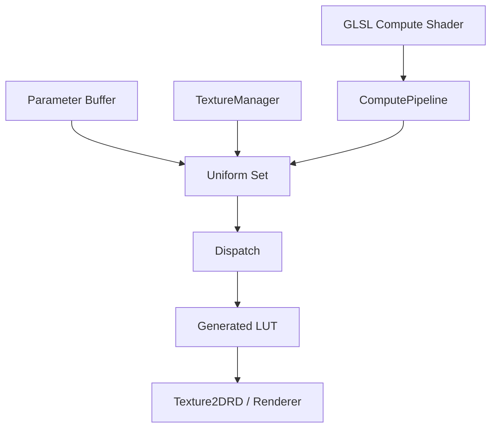

The atmosphere-specific implementation then only needs to answer:

```text
What does each texel represent?

What parameters does the integration need?

How many samples are required?

What texture format is appropriate?

When does this LUT need to regenerate?

Who consumes it?
```

Those are the questions the next rendering phases will answer.

The GPU infrastructure should not need to change.

---

## Resource Lifetime Becomes More Important Later

At this stage there is only one smoke-test texture.

Later, the renderer will have several long-lived GPU resources:

```text
Transmittance LUT
Multiple-Scattering LUT
Sky-View LUT
Cloud Shadow Map
Compute Pipelines
Uniform Buffers
Uniform Sets
Texture2DRD wrappers
```

Some will be rebuilt when structural parameters change.

Some will be updated every frame.

Some will persist for the lifetime of the atmosphere system.

Some will be replaced while the renderer is still using the previous resource.

That means ownership cannot be treated as cleanup boilerplate.

It becomes part of the renderer's architecture.

The later LUT implementations therefore build on the same ownership model established here.

---

## Why Regeneration Needs a Lifecycle

Consider the transmittance LUT.

The atmosphere's Rayleigh strength changes.

The old LUT is still the one currently exposed to the sky shader.

The new LUT needs to be generated.

A safe lifecycle is:

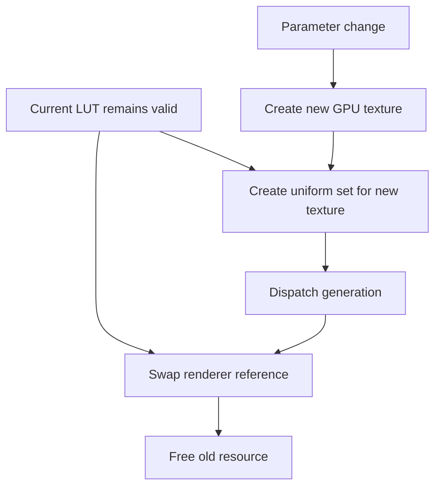

This pattern is established by the infrastructure even though the actual double-buffered LUT implementation comes later.

The principle is simple:

> **Generate the replacement before destroying the resource currently in use.**

That matters enormously once GPU work and frame scheduling become involved.

---

## Testing in a Renderer Context

There is another subtle requirement here.

Not every environment has a usable GPU rendering device.

Headless execution and the Compatibility renderer can make the compute path unavailable.

The test suite therefore treats device availability as an environmental condition rather than as a reason to crash.

When a RenderingDevice is unavailable, GPU-specific tests report the condition and exit cleanly.

This distinction matters for CI:

```text
GPU available
    ↓
run GPU assertions

GPU unavailable
    ↓
report GPU tests as unavailable
    ↓
do not pretend they passed
    ↓
do not crash the entire test suite
```

The test result should distinguish:

```text
PASS
FAIL
NOT AVAILABLE
```

rather than silently treating "could not run" as "worked."

---

## What the Infrastructure Actually Guarantees

At the end of this phase, the renderer has a reusable foundation that can establish the following chain:

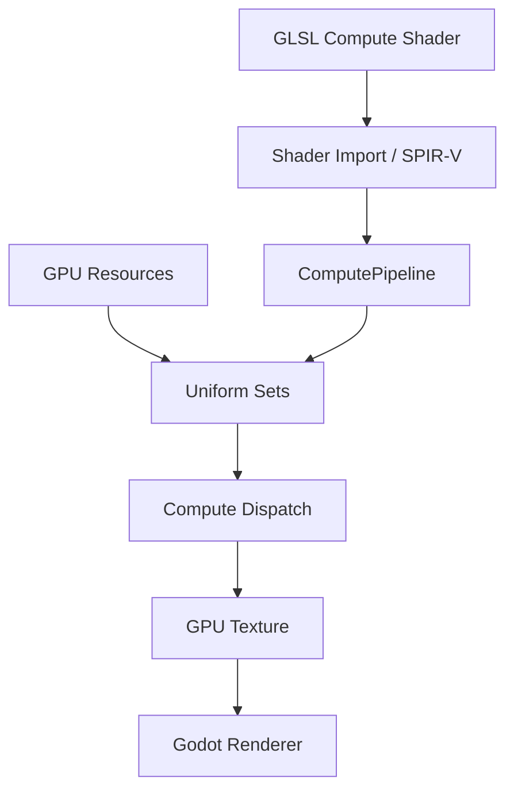

The infrastructure provides:

- RenderingDevice abstraction,
- main/local device compatibility,
- compute shader loading,
- SPIR-V validation,
- compute pipeline creation,
- GPU texture management,
- GPU buffer management,
- uniform-set ownership,
- workgroup calculation,
- explicit resource cleanup,
- deterministic local-device testing,
- renderer-visible main-device resources,
- and actionable error reporting.

It deliberately does **not** provide the atmosphere mathematics.

That comes next.

---

## What This Does Not Solve

It is worth being precise about what has *not* been solved yet.

At this point:

```text
✓ GPU compute works
✓ GPU textures can be created
✓ shaders can be loaded
✓ parameters can be uploaded
✓ dispatch works
✓ results can be validated
✓ renderer-visible resources can be created
```

But:

```text
✗ no atmospheric scattering
✗ no transmittance
✗ no multiple scattering
✗ no sky-view radiance
✗ no custom atmospheric sky
```

The system has a GPU foundation.

It does not have an atmosphere yet.

And that distinction is important because the next phase can now focus almost entirely on the physics.

---

## What This Enables

The next LUT implementation can now be almost embarrassingly straightforward from an infrastructure perspective.

A transmittance pass only needs to:

```text
write GLSL
    ↓
create pipeline
    ↓
create RGBA32F texture
    ↓
upload atmosphere parameters
    ↓
dispatch
    ↓
expose texture
```

The same infrastructure can then support:

```text
Transmittance
      ↓
Multiple Scattering
      ↓
Sky View
      ↓
Aerial Perspective
```

and later cloud-specific compute resources.

This is why this phase exists before the atmospheric mathematics.

The goal is not to make the first sky appear as quickly as possible.

The goal is to make every subsequent GPU pass **boring to integrate**.

---

## The Trade-Off We Are Making

Returning to the decision at the beginning:

This architecture chooses runtime compute.

That buys us a useful property:

```text
Atmosphere parameters
        ↓
GPU regeneration
        ↓
new LUT state
        ↓
runtime renderer
```

The system can therefore respond to changes that affect precomputed atmospheric data rather than treating those textures as immutable assets.

The cost is platform scope.

The renderer depends on the compute-shader path provided by the Forward+ / Vulkan architecture.

An alternative design could instead be:

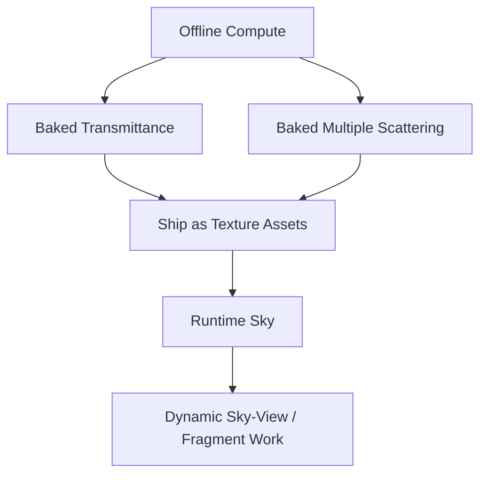

That architecture is valid.

It changes the trade-off.

The important thing is that the renderer target is a **conscious architectural choice**, not an accidental consequence discovered after the system has already been built.

For this series, the choice is runtime GPU compute.

Now we can build on it.

---

## What We Learned

A few lessons from this phase are worth carrying through the rest of the series.

### 1. Separate GPU mechanics from GPU mathematics

The atmosphere should not have to reinvent:

```text
shader loading
pipeline creation
texture allocation
resource cleanup
dispatch sizing
```

for every LUT.

The infrastructure exists so that rendering passes can focus on what they are actually computing.

### 2. Main and local RenderingDevices serve different purposes

The main device is for renderer integration.

The local device is useful for deterministic testing and readback.

Treating them as interchangeable leads to subtle failures, particularly around `Texture2DRD`.

### 3. Make ownership explicit

A GPU RID without an obvious owner is a future leak.

Every resource should have a clear answer to:

```text
Who created it?
Who uses it?
Who replaces it?
Who frees it?
```

### 4. Start with the dumbest possible shader

A gradient tells us more about the health of the compute pipeline than a broken atmosphere shader ever could.

The first test should remove complexity, not demonstrate it.

### 5. The renderer target belongs in the architecture document

The Forward+ / compute dependency affects the project's supported rendering path.

That is not an implementation footnote.

It is part of the renderer's design contract.

### 6. Test the GPU and the renderer separately

A numerical compute result being correct does not prove that Godot can consume the resource.

Conversely, a renderer-visible texture does not prove that the compute shader generated the right values.

Both paths need validation.

---

## The Architecture So Far

The project can now be viewed as two layers:

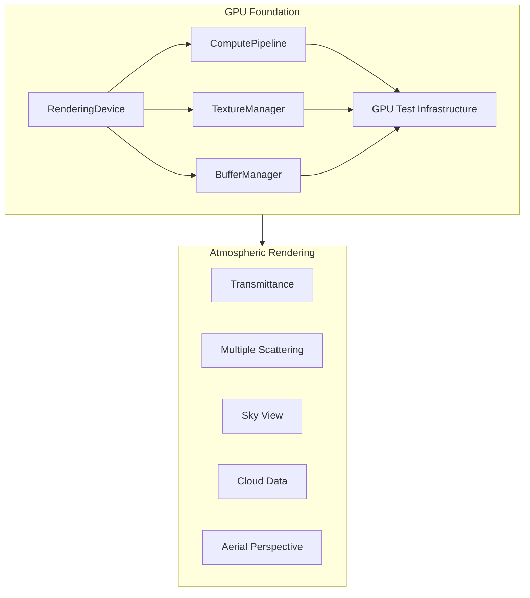

The bottom layer knows how to talk to the GPU.

The upper layer will decide what the GPU should calculate.

That separation is the foundation for everything that follows.

---

## Up Next: First Light

Now that the compute path exists, we can finally ask the first genuinely atmospheric question:

> **How much sunlight survives a journey through the atmosphere?**

The answer becomes the first real LUT:

**transmittance.**

That phase introduces the spherical atmosphere model, ray–sphere intersections, altitude-dependent density, numerical integration, Beer's law, CPU/GPU validation, and the first real GPU-generated atmospheric data.

The infrastructure is ready.

Time to give it something worth calculating.

---

## References

- [Godot 4.5 — Using Compute Shaders](https://docs.godotengine.org/en/4.5/tutorials/shaders/compute_shaders.html)
- [Godot 4.5 — RenderingDevice](https://docs.godotengine.org/en/4.5/classes/class_renderingdevice.html)
- [Godot 4.5 — Texture2DRD](https://docs.godotengine.org/en/stable/classes/class_texture2drd.html)
- [Sebastian Hillaire — "A Scalable and Production Ready Sky and Atmosphere Rendering Technique"](https://sebh.github.io/publications/egsr2020.pdf)

---

*Part 02 is where the GPU starts doing atmospheric work. This part was just making sure it had somewhere to do it.*
