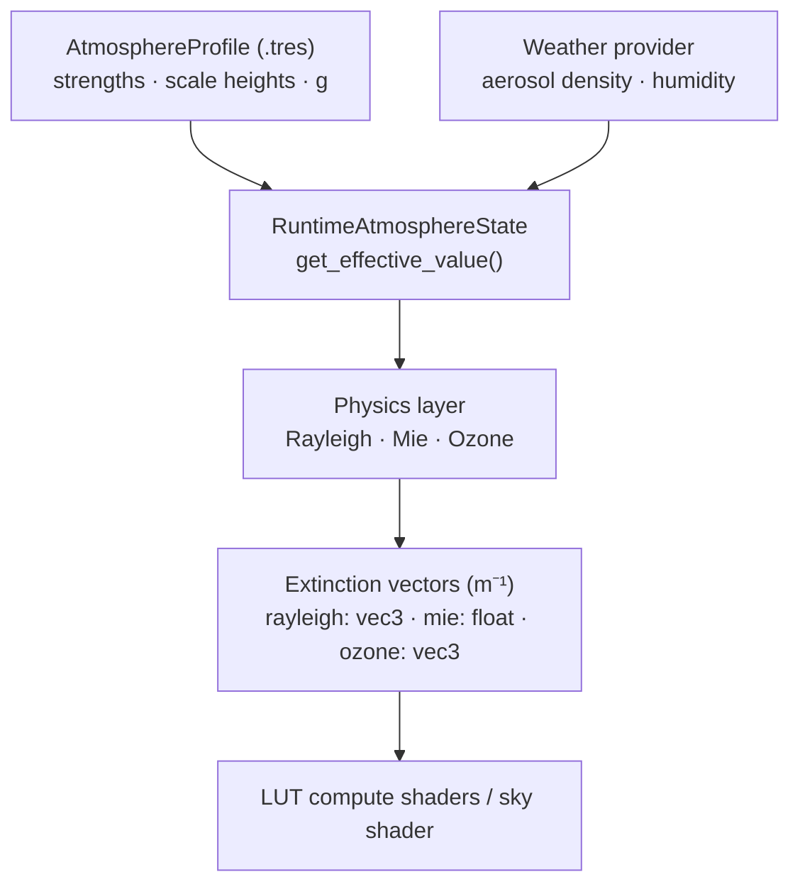
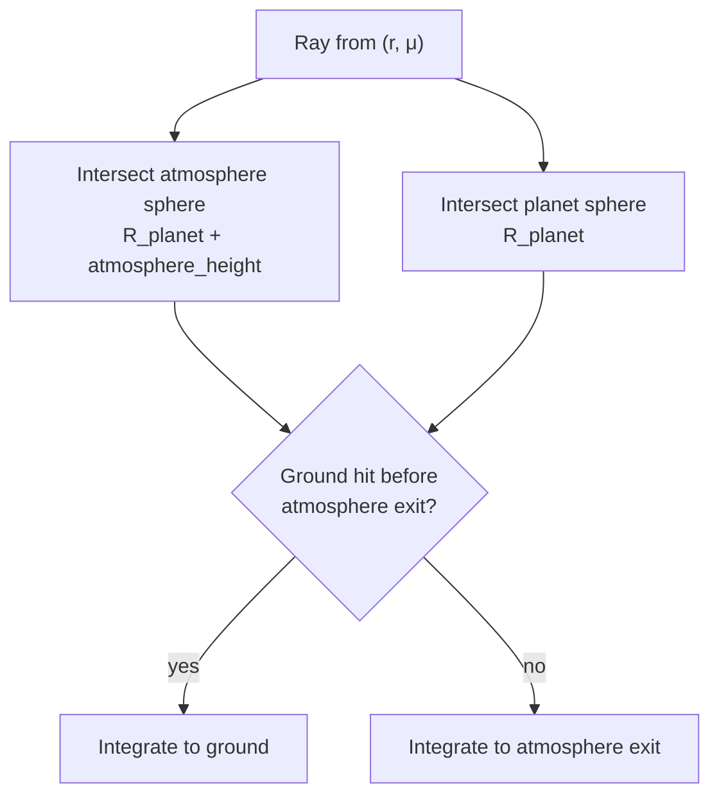
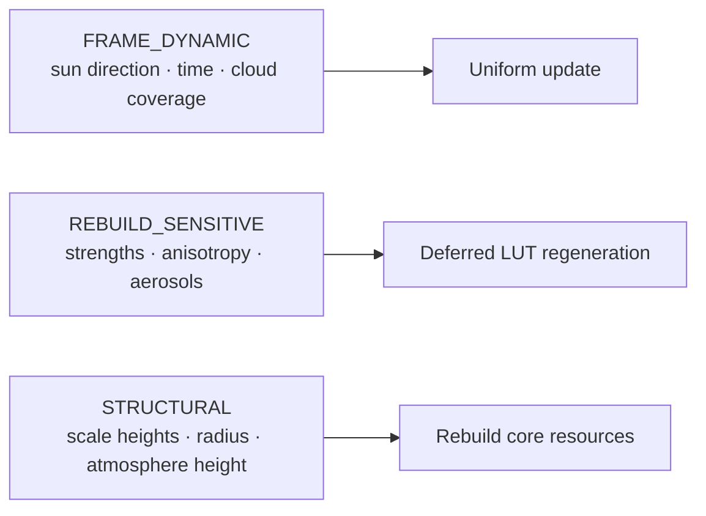

The very first physical number this renderer ever produced was wrong by **six orders of magnitude**.

Not "a bit too blue". Not "the sunset is slightly off". The Rayleigh scattering coefficient for green light came out at roughly $4 \times 10^{-12}\ \text{m}^{-1}$ instead of roughly $1.2 \times 10^{-5}\ \text{m}^{-1}$. An atmosphere with that coefficient is, for all practical purposes, a vacuum.

And the best part? The test I had written to check the Rayleigh maths *passed*.

I'll come back to why. But that bug sets the tone for this whole post nicely. The introduction to this series was the map, and the last post built the GPU plumbing: devices, pipelines, buffers and textures, all ready and waiting for something worth computing. This post is that something. It's the ground floor: the handful of small, boring-looking GDScript classes that every LUT, every shader and every sunset in the renderer ultimately depends on. If these numbers are wrong, nothing downstream can save you, and nothing downstream will *tell* you either. You just get a sky that looks "off" and a week of staring at compute shaders.

So, let's build the physics layer properly.

---

## Why Bother With a CPU Physics Layer?

The renderer does all of its heavy lifting on the GPU. So why does it have a `core/scattering/` folder full of GDScript?

```text
core/scattering/
├── wavelength.gd       # 680 / 550 / 440 nm
├── density.gd          # exp(-h / H)
├── rayleigh.gd         # β_R(λ) from first principles
├── mie.gd              # Henyey-Greenstein + aerosol coefficient
├── ozone.gd            # Gaussian layer + RGB absorption
├── optical_depth.gd    # τ and Beer's law helpers
└── transmittance.gd    # spherical ray march (CPU reference)
```

Three reasons:

1. **The coefficients are derived once, on the CPU, and the GPU only ever receives numbers.** No compute shader in this project knows what a refractive index is. They get `rayleigh_extinction` as a `vec3` in m⁻¹ and get on with it.
2. **These classes are the CPU reference.** When a LUT comes out black, I want to be able to evaluate the same integral in GDScript and compare. That only works if the CPU side is the source of truth.
3. **They are trivially testable headlessly.** No `RenderingDevice`, no window, no GPU. Phases 4, 5 and 6 of the project are basically "write the maths, then write the tests that prove the maths".

Every one of these classes is a `RefCounted` with `static func`s. No state, no nodes, no lifecycle. That is deliberate: the hardest-to-debug part of a renderer is state, so the physics has none.

---

## From Artist Sliders to m⁻¹

Before any physics, there's a design question that shapes everything: **what does an artist actually edit?**

Nobody wants to type `1.2186e-05` into an Inspector. So the `AtmosphereProfile` exposes *strengths* and *heights*, and the maths converts them into physical coefficients internally:

```gdscript
@export_group("Rayleigh")
@export_range(0.0, 10.0, 0.01) var rayleigh_strength: float = 1.0
@export_range(1000.0, 20000.0, 100.0) var rayleigh_scale_height: float = 8000.0

@export_group("Mie")
@export_range(0.0, 10.0, 0.01) var mie_strength: float = 1.0
@export_range(100.0, 20000.0, 50.0) var mie_scale_height: float = 1200.0
@export_range(-0.99, 0.99, 0.01) var mie_anisotropy: float = 0.76

@export_group("Ozone")
@export_range(0.0, 10.0, 0.01) var ozone_strength: float = 1.0
@export_range(10000.0, 50000.0, 1000.0) var ozone_layer_center: float = 25000.0
@export_range(1000.0, 30000.0, 1000.0) var ozone_layer_width: float = 15000.0
```

A strength of `1.0` means "Earth". A strength of `2.0` means "twice Earth". The physical coefficient is always `strength × reference_coefficient`, which means an artist never has to know what the reference coefficient is, and I can change *how* it's derived without breaking a single `.tres` file.

Planet geometry lives in a separate `PlanetProfile` (radius `6 371 000 m`, atmosphere height `100 000 m` by default). Scattering parameters and geometry change for different reasons and at different rates, so they don't share a Resource.

But the profile is *configuration*. It never goes to the GPU directly. There's one more layer in between:



`RuntimeAtmosphereState` reads the profile and layers runtime overrides (weather, mostly) on top, **without ever writing back to the Resource**. The renderer asks it for effective values:

```gdscript
func get_effective_value(parameter_name: StringName) -> Variant:
	# Override wins.
	if _weather_overrides.has(parameter_name):
		return _weather_overrides[parameter_name]

	# Profile fallback — only for parameters that have a direct profile field.
	match parameter_name:
		&"rayleigh_strength":
			return atmosphere_profile.rayleigh_strength if atmosphere_profile != null else null
		# ...
```

Why so paranoid about mutation? Because `.tres` Resources are *shared*. If a thunderstorm bumped `mie_strength` directly on the profile, every scene using that preset would inherit the storm, and in the editor that change would quietly get saved to disk. Overrides in runtime state die with the runtime state. That's the whole point.

---

## Three Wavelengths Pretending to Be a Spectrum

Real sunlight is a continuous spectrum. This renderer uses three numbers:

```gdscript
const RED_NM: float = 680.0
const GREEN_NM: float = 550.0
const BLUE_NM: float = 440.0
```

That's the standard RGB approximation used in a lot of real-time atmosphere work, and the reason it's acceptable is that the effects we care about (blue sky, orange sunset, haze) are driven by *how strongly scattering varies across the visible range*. Three samples across that range capture the trend well enough.

What it can't do is anything genuinely spectral: no colour shifts that depend on a narrow absorption band falling *between* two of these samples. That's a conscious trade-off, and every channel-wise `Vector3` in the physics layer inherits it.

---

## Rayleigh: Why the Sky Is Blue (and How I Made It Transparent)

Rayleigh scattering is what happens when light hits particles much smaller than its wavelength, which in our case means air molecules. The scattering coefficient is:

$$
\beta_R(\lambda) = \frac{8\pi^3 (n^2 - 1)^2}{3 N \lambda^4}
$$

where $n$ is the refractive index of air, $N$ is the molecular number density at sea level, and $\lambda$ is the wavelength.

The important part is the $\lambda^4$ in the denominator. Shorter wavelengths scatter *much* more. Between our red and blue samples:

$$
\left(\frac{680}{440}\right)^4 \approx 5.70
$$

Blue light scatters almost six times more than red. Look up, and you see blue because blue is the light that's been bounced toward you from all over the sky. Look at the sun near the horizon, and you see what's *left* after a long path has scattered the blue away. Same equation, opposite consequence.

The implementation derives the coefficient from first principles rather than hard-coding the textbook values:

```gdscript
const REFRACTIVE_INDEX: float = 1.000293
const NUMBER_DENSITY: float = 2.547e25

static func coefficient(wavelength_m: float) -> float:
	var n: float = REFRACTIVE_INDEX
	var N: float = NUMBER_DENSITY
	var lam: float = wavelength_m
	# (n²−1)² — the refractive term. NOTE: compute the square exactly once;
	# the squared product below becomes (n²−1)⁴ and destroys the magnitude.
	var n2m1: float = n * n - 1.0
	var n2m1_sq: float = n2m1 * n2m1
	# 8π³(n²−1)²
	var numerator: float = 8.0 * PI * PI * PI * n2m1_sq
	# 3Nλ⁴
	var lam2: float = lam * lam
	var denominator: float = 3.0 * N * lam2 * lam2
	return numerator / denominator
```

With these constants, the three channels come out at:

| Channel | λ | $\beta_R$ (m⁻¹) |
|---|---|---|
| Red | 680 nm | $5.22 \times 10^{-6}$ |
| Green | 550 nm | $1.22 \times 10^{-5}$ |
| Blue | 440 nm | $2.98 \times 10^{-5}$ |

These are in the same ballpark as the coefficients you'll find in the Bruneton and Hillaire papers. The small differences come from the exact $n$ and $N$ used.

### The bug

Now look at that `NOTE:` comment again. It exists because the first version of this function looked like this:

```gdscript
# (n²−1)² — the refractive term
var n2m1_sq: float = (n * n - 1.0) * (n * n - 1.0)
n2m1_sq *= n2m1_sq
```

Yep. I squared it, and then squared it *again*. $(n^2 - 1)^4$ instead of $(n^2 - 1)^2$.

Since $n^2 - 1 \approx 5.86 \times 10^{-4}$, squaring it one extra time multiplies the whole coefficient by about $3.4 \times 10^{-7}$. Green light went from $1.22 \times 10^{-5}$ to roughly $4 \times 10^{-12}$ per metre. Over a 100 km atmosphere that's an optical depth of about $4 \times 10^{-7}$. Completely transparent. A black sky with a sun in it.

Here's the part I find genuinely instructive. The first test I'd written was the *physically meaningful* one:

```gdscript
# Blue must scatter exactly (red/blue wavelength)⁴ times more than red.
var expected_ratio: float = pow(Wavelength.RED_NM / Wavelength.BLUE_NM, 4.0)
var ratio_br: float = beta_r.z / beta_r.x
_assert_approx(ratio_br, expected_ratio, 0.01, "Blue/Red ratio = (680/440)⁴")
```

And that test **passes with the bug**. Of course it does. The extra $(n^2 - 1)^2$ is the same constant for every wavelength, so it cancels out of the ratio completely. The wavelength dependence was perfect. The magnitude was garbage.

The check that actually catches it is the dumb one:

```gdscript
# Typical Rayleigh coefficient at 550nm is ~1.17e-5 m⁻¹; exact value depends on n and N.
_assert_approx(beta_r.y, 1.17e-5, 0.2e-5, "Green coefficient ~1.17e-5 m⁻¹")
```

The fix and that magnitude test landed in commits 25 seconds apart, which tells you exactly how that evening went.

The lesson I took away from it: **a relative test proves the shape of a function. Only an absolute test proves its scale.** For physical constants you need both, and the "boring" order-of-magnitude assertion is the one that saves you.

---

## Density: How Thick Is the Air Up There?

A coefficient tells you how much a unit of *sea-level* air scatters. Air gets thinner with altitude, so every coefficient is multiplied by a density profile.

For Rayleigh and Mie, that's a plain exponential:

$$
\rho(h) = e^{-h / H}
$$

```gdscript
static func exponential(h: float, scale_height: float) -> float:
	return exp(-h / scale_height)
```

$H$ is the **scale height**: the altitude over which density drops by a factor of $e$. The defaults are `8000 m` for air molecules and `1200 m` for aerosols.

That difference matters more than it looks. Aerosols (dust, water droplets, pollution) are heavy and hug the ground; molecules are spread much higher. At 5 km:

```text
Rayleigh: exp(-5000 / 8000) ≈ 0.535   → about half the sea-level air is still there
Mie:      exp(-5000 / 1200) ≈ 0.016   → aerosols are essentially gone
```

This is why haze is a low-altitude phenomenon and why the sky looks deeper blue from a mountaintop. Fly a camera up a few kilometres and the Mie contribution simply falls away, while Rayleigh keeps going. The renderer gets that behaviour for free from two exponentials with different $H$.

`DEVELOPMENT.md` explicitly says *don't build a layered atmosphere simulator in the first pass*. A single exponential per component is a simplification of the real atmosphere's temperature structure, but it's the right one to start with, and the density functions are isolated enough to be swapped for layered profiles later.

---

## Mie: The Glow Around the Sun

Mie scattering covers particles comparable to or larger than the wavelength: aerosols, haze, fine droplets. Two things make it behave completely differently from Rayleigh:

1. It's **weakly wavelength-dependent**, which is why haze looks white-grey rather than blue.
2. It's **strongly forward-scattering**. Most of the scattered light keeps going roughly the same direction, which is what produces the bright halo around the sun.

### The phase function

Rayleigh's angular distribution is gentle and symmetric ($\frac{3}{16\pi}(1 + \cos^2\theta)$, which the GPU shaders evaluate directly). Mie needs something with a strong forward peak. The project uses the **Henyey-Greenstein** phase function:

$$
P(\cos\theta) = \frac{1 - g^2}{4\pi \left(1 + g^2 - 2g\cos\theta\right)^{3/2}}
$$

$g$ is the anisotropy: `0` is isotropic, positive values push light forward, negative values push it back. The default is `0.76`.

```gdscript
static func phase_henyey_greenstein(cos_theta: float, g: float) -> float:
	# Isotropic limit: g → 0 gives uniform 1/(4π).
	if absf(g) < 1e-6:
		return 1.0 / (4.0 * PI)

	var g2: float = g * g
	var denom: float = 1.0 + g2 - 2.0 * g * cos_theta
	denom = maxf(denom, 1e-10)  # Guard against float noise at g≈1, cos≈1.
	return (1.0 - g2) / (4.0 * PI * pow(denom, 1.5))
```

Two small guards worth pointing out:

- The **isotropic early-out** isn't strictly necessary (the formula reduces to $1/4\pi$ at $g = 0$ anyway), but it makes the intent explicit and gives the tests an exact value to check against.
- The **denominator clamp** matters near $g \to 1$ looking straight at the sun, where $1 + g^2 - 2g$ heads toward zero and `pow(denom, 1.5)` would blow up.

How lopsided is $g = 0.76$? Plugging the endpoints into the formula:

```text
P(forward,  cos θ =  1) = (1 − g²) / (4π (1 − g)³)  ≈ 2.43
P(backward, cos θ = −1) = (1 − g²) / (4π (1 + g)³)  ≈ 0.0062
```

Forward scattering is almost **400×** stronger than backward scattering. That's the halo.

The validation explicitly rejects $|g| \geq 1$, because the function becomes a delta at that point:

```gdscript
# Henyey-Greenstein phase function has a singularity at g = ±1.
if mie_anisotropy <= -1.0 or mie_anisotropy >= 1.0:
	errors.append("Mie anisotropy must be between -1 and 1 (exclusive)")
```

The Inspector slider used to run all the way to ±1, which meant you could drag it straight into a value `validate()` would then reject. It now stops at ±0.99, so the UI can't produce an invalid profile in the first place.

### The coefficient (and what I left out)

```gdscript
const BASE_COEFFICIENT: float = 21.0e-6

static func coefficients_rgb(mie_strength: float) -> Vector3:
	var beta_m: float = coefficient(mie_strength)
	return Vector3(beta_m, beta_m, beta_m)
```

The Mie coefficient is a single grey value, $21 \times 10^{-6}\ \text{m}^{-1}$ at strength `1.0`, identical across channels. There's no particle-size distribution, no real Mie theory, and, importantly, **no separate absorption term**. The same value is used for both scattering and extinction, so aerosols in this model scatter everything they intercept and absorb nothing.

That's a simplification you should know about. Hillaire's model, for example, gives aerosols a small absorption component. Leaving it out makes the haze very slightly brighter than it would otherwise be. For Core 1.0 I judged that an acceptable trade for one fewer parameter that nobody would tune.

It also means "dust" can't be coloured. The Mars preset gets its look by turning Rayleigh down to `0.15` and stretching the Mie scale height to `10 000 m`, but its aerosols are still grey. A genuinely butterscotch Martian sky would need wavelength-dependent Mie, which is firmly on the "later" list.

---

## Ozone: The Layer That Only Absorbs

Rayleigh and Mie *scatter*: they redirect light, which is what makes the sky glow. Ozone mostly *absorbs*: light that hits it is simply gone. In this renderer, ozone appears in the **extinction** sum and nowhere else. It never adds in-scattered light.

It also doesn't live near the ground. Ozone concentrates in a layer high in the stratosphere, so the exponential profile is the wrong shape entirely. The project uses a Gaussian layer instead:

$$
\rho_{O_3}(h) = e^{-\left(\frac{h - h_c}{w}\right)^2}
$$

with a default centre $h_c$ of 25 km and width $w$ of 15 km.

```gdscript
static func density(h: float, layer_center: float, layer_width: float) -> float:
	var dh: float = (h - layer_center) / layer_width
	return exp(-dh * dh)
```

(Hillaire uses a tent function, a linear ramp up and down around 25 km. The Gaussian is smoother, has no kinks for the ray marcher to step over, and is just as cheap.)

The absorption is expressed as a dimensionless RGB shape times a physical base coefficient:

```gdscript
## Ratios follow the Bruneton / Hillaire / Unreal references
## (0.650, 1.881, 0.085) / 1.881: red absorbs about a third as much as
## green, and blue is nearly transparent.
const ABSORPTION_RGB: Vector3 = Vector3(0.345, 1.0, 0.045)

## Base ozone extinction coefficient (m^-1) at the layer peak.
const BASE_OZONE_EXTINCTION: float = 1.06e-6
```

So at the peak of the layer, ozone extinction is `1.06e-6 × (0.345, 1.0, 0.045)` m⁻¹: strongest in green, about a third of that in red, and almost nothing in blue.

Why does a renderer care about a gas that mostly absorbs? Because of twilight. When the sun is below the horizon, the light still reaching the zenith has travelled a very long, mostly high-altitude path, which is exactly where the ozone sits. Ozone eats the green and red along that path and leaves the blue alone, and that is a big part of why the sky overhead stays blue after sunset instead of turning grey. Without the ozone term, twilight in a scattering-only model looks noticeably wrong.

### Getting ozone wrong, quietly

The first version of these two constants was wrong in a way no screenshot was ever going to flag:

```gdscript
# Before
const ABSORPTION_RGB: Vector3 = Vector3(0.15, 1.0, 0.45)
const BASE_OZONE_EXTINCTION: float = 3.5e-6
```

I'd reasoned that blue "absorbs moderately" thanks to the tail of the Huggins band. That's simply wrong: Huggins is a UV band (310–340 nm) and doesn't get anywhere near 440 nm. The Chappuis band is broad around 600 nm and falls off steeply toward blue. So the old values absorbed **ten times** too much blue relative to green, which works directly against the one job ozone has in this renderer: keeping the twilight zenith blue.

The base coefficient was off too. With a 15 km Gaussian it produced a vertical green column of about 0.09, roughly **three times** the reference. The new value is chosen so the default layer lands at about 0.028, matching the Bruneton/Hillaire reference.

What makes this kind of bug sneaky is that the old values passed their own tests. Phase 6 checked "green > red", "green > blue" and, yes, "blue > red". The tests faithfully encoded my mistake. They now check the reference ordering, plus a column test that pins the actual magnitude, which is the Rayleigh lesson again: **test the scale, not just the shape.**

---

## Optical Depth: Adding It All Up

Now we have three components, each with a coefficient and a density profile. The quantity that ties them together is **optical depth**: the integral of total extinction along a path.

$$
\tau = \int_{\text{path}} \Big( \beta_R \, \rho_R(h) + \beta_M \, \rho_M(h) + \beta_{O_3} \, \rho_{O_3}(h) \Big) \, ds
$$

And from optical depth, Beer's law gives transmittance, the fraction of light that survives the path:

$$
T = e^{-\tau}
$$

On the GPU, the per-sample extinction is exactly that sum, per channel:

```glsl
float rho_r = rayleigh_density(h);
float rho_m = mie_density(h);
float rho_o = ozone_density(h);

vec3 ext = params.rayleigh_extinction * rho_r
         + params.mie_extinction * rho_m
         + params.ozone_extinction * rho_o;
```

Note that `mie_extinction` is a scalar `float` and the other two are `vec3`s. That's the grey-Mie simplification from earlier, showing up in the uniform layout.

### What do the numbers actually say?

Before trusting any LUT, I like to know roughly what the answer *should* be. For a vertical column straight up from sea level, each integral has a closed form:

- Exponential: $\int_0^\infty e^{-h/H}\,dh = H$
- Gaussian: $\int_{-\infty}^{\infty} e^{-((h - h_c)/w)^2}\,dh = \sqrt{\pi}\,w$ (the part below sea level is under 1% here, so this is close enough)

So the zenith optical depth is just coefficient × length:

| Component | Column length | τ red | τ green | τ blue |
|---|---|---|---|---|
| Rayleigh | $H_R = 8000$ m | 0.042 | 0.097 | 0.238 |
| Mie | $H_M = 1200$ m | 0.025 | 0.025 | 0.025 |
| Ozone | $\sqrt{\pi} \cdot 15\,000 \approx 26\,600$ m | 0.010 | 0.028 | 0.001 |
| **Total** | | **0.077** | **0.151** | **0.264** |

$$
T_{\text{zenith}} = e^{-\tau} \approx (0.93,\ 0.86,\ 0.77)
$$

So with the sun directly overhead, roughly 93% of the red, 86% of the green and 77% of the blue reach the ground. The missing blue hasn't vanished: it's been scattered *sideways*, and that's the sky.

If you port the 64-step trapezoid ray march from the transmittance code to Python and run it straight up from the ground, you get `(0.080, 0.154, 0.269)`. That's within about 5% of the closed form, and the error has an obvious cause: 64 steps over 100 km is about 1.6 km per step, which is coarser than the 1.2 km Mie scale height, so the trapezoid overestimates the thin aerosol layer slightly. That's exactly the kind of sanity check that gives me confidence before a single texel hits the GPU.

These numbers also show something you'd never spot from a screenshot: the balance between components. Rayleigh dominates every channel, Mie is a flat grey offset, and ozone barely touches blue. This table is also how the old ozone values got caught. With them, ozone's green column was almost as large as Rayleigh's, which is not what Earth's atmosphere looks like.

---

## Why Plane-Parallel Isn't Enough

`optical_depth.gd` contains the classic textbook shortcut, the **plane-parallel** approximation:

```gdscript
## [code]tau_ray = tau_vertical / cos(theta)[/code]
static func ray(h: float, scale_height: float, zenith_cos: float, extinction: float = 1.0) -> float:
	var tau_v: float = vertical(h, scale_height, extinction)
	var cos_theta: float = maxf(zenith_cos, 0.01)
	return tau_v / cos_theta
```

(A small but real fix here: `vertical()` used to return $H e^{-h/H}$ and call it an optical depth. That's a *length* in metres, the equivalent column of sea-level air, and it only becomes a dimensionless $\tau$ once you multiply it by an extinction coefficient. There's now a separate `column_length()`, and `vertical()` / `ray()` take the coefficient explicitly. The default of `1.0` keeps old callers working, but the names no longer lie about the units.)

Treat the atmosphere as a flat slab, and a slanted ray just sees $1/\cos\theta$ times the vertical column. At 60° from the zenith that's 2×, which is perfectly reasonable.

At the horizon, $\cos\theta \to 0$ and the slab gets infinitely long. Hence the `0.01` clamp, which caps it at 100×.

But the real atmosphere is a shell around a sphere, and a horizontal ray curves *out* of it. For an exponential atmosphere, the grazing column works out to approximately:

$$
\frac{\tau_{\text{horizon}}}{\tau_{\text{vertical}}} \approx \sqrt{\frac{\pi R}{2H}} = \sqrt{\frac{\pi \cdot 6\,371\,000}{2 \cdot 8000}} \approx 35
$$

So the flat-slab answer is wrong by about 3× exactly where it matters most: sunsets, and the band of sky just above the horizon. That's where all the interesting colour is.

The plane-parallel helpers are still in the codebase and still tested, but none of the LUTs use them. Everything that gets precomputed goes through spherical geometry. There are two places that deliberately keep a flat model because they have to be cheap: the ambient-light approximation, and the night-sky glow you'll meet a bit further down, which clamps its airmass at 10 instead of 100 for exactly the horizon reason above. Both are approximations of something faint or diffuse, where a 3× error near the horizon is far less visible than it would be in a sunset.

---

## Spherical Geometry: r, μ and the Sun Behind the Planet

The spherical model describes any viewpoint with just two numbers:

- $r$: distance from the planet centre
- $\mu$: the cosine of the angle between the view direction and local "up"

That's enough because the planet is a sphere: rotate the whole world and nothing changes. This 2D parameterisation is also exactly what the transmittance LUT stores, which is where the next post picks up.

The core primitive is ray-sphere intersection, which both the CPU reference and the GPU shaders share:

```glsl
// Returns (t0, t1) or (-1, -1) on miss.
vec2 ray_sphere(vec3 origin, vec3 direction, float radius) {
    float b = 2.0 * dot(origin, direction);
    float c = dot(origin, origin) - radius * radius;
    float disc = b * b - 4.0 * c;
    if (disc < 0.0) {
        return vec2(-1.0, -1.0);
    }
    float sq = sqrt(disc);
    return vec2((-b - sq) * 0.5, (-b + sq) * 0.5);
}
```

Every ray gets intersected against two spheres, the planet and the top of the atmosphere, and the integral runs from the camera to whichever one it reaches first.



Simple, right? Well...

### The sun that shone through the Earth

Integrating to the ground is correct for a *view* ray. You look down, you see terrain, the atmosphere between you and the terrain is what tints it.

It's not correct for a *sun* ray. Transmittance toward the sun answers "how much sunlight reaches this point?" If the path to the sun goes through the planet, the answer is **zero**, not "the small amount of air between here and the ground".

The original code didn't make that distinction. A sun just below the horizon produced a ray that hit the ground almost immediately, accumulated almost no optical depth, and therefore reported almost full transmittance. The sun was shining straight through the planet.

The first fix, back in September, went into the CPU reference and treated any $\mu < 0$ as "sun below horizon, transmittance zero". That fixed the surface case on the CPU side, while the GPU LUT quietly kept integrating to the ground until much later. But it's subtly wrong as soon as you leave the ground, because the horizon *dips* with altitude. From height $h$, the geometric horizon sits below the local horizontal by:

$$
\cos(\text{dip}) = \frac{R}{R + h}
$$

| Altitude | Horizon dip | Lowest μ that still sees the sun |
|---|---|---|
| 2 km | 1.4° | −0.025 |
| 10 km | 3.2° | −0.056 |
| 50 km | 7.2° | −0.125 |

From an aircraft at 10 km, the sun can be over 3° below the local horizontal and still be perfectly visible. A flat $\mu < 0$ test turns it off too early.

The current version tests the actual geometry instead: does the ray's closest approach to the planet centre fall inside the planet?

```glsl
// True when a ray from radius r with zenith cosine mu strikes the planet.
bool ray_hits_ground(float r, float mu) {
    if (mu >= 0.0) {
        return false;
    }
    // Closest approach to the planet centre is r * sin(theta).
    float min_dist_sq = r * r * (1.0 - mu * mu);
    return (min_dist_sq < params.planet_radius * params.planet_radius) || (r <= params.planet_radius);
}
```

And then in the LUT:

```glsl
// Rays that hit the ground never reach the sun: transmittance is zero.
vec3 tau = optical_depth(r, mu);
vec4 transmittance = ray_hits_ground(r, mu) ? vec4(0.0, 0.0, 0.0, 1.0) : vec4(exp(-tau), 1.0);
```

$r \sin\theta$ is the perpendicular distance from the planet centre to the ray's line, so comparing its square against $R^2$ answers "does this ray clip the planet?" with no square roots and no special cases for altitude. The CPU reference got the same `ray_hits_ground` helper in the same commit, plus tests for both the dip and the ground block.

### Fixing the sun turned the night black

Oh yes, correctness has side effects.

The sky-view LUT is lit *only* by the sun. Before this fix, a sun a few degrees below the horizon still leaked a little light through the planet, and that leak was quietly doing a job: it kept a faint blue glow in the sky after sunset. Once the planet blocks the sun properly, that glow goes, and the atmosphere goes completely black at night. Stars, moon and Milky Way all still render, but on top of a void.

A real night sky isn't black, though, and the reason isn't leaked sunlight. There are two weak sources of light the sun-only LUT never modelled, and they now live in a small sky-shader include, `night_atmosphere.gdshaderinc`:

1. **Airglow.** The upper atmosphere emits a faint light from a thin layer around 90 km. A ray near the horizon crosses that shell at a shallow angle, so it travels a longer path through it and the horizon gets brighter. That's the **van Rhijn effect**.
2. **Moonlit sky.** Moonlight is just dim, slightly warm sunlight, so it gets Rayleigh-scattered exactly like sunlight does. Same coefficients, much less light.

```glsl
// Van Rhijn factor: path length through a thin emission shell at radius
// r_glow, relative to the zenith path, for an observer at radius r.
float na_van_rhijn(float mu, float r, float r_glow) {
    float k = r / r_glow;
    float sin2 = 1.0 - mu * mu;
    return 1.0 / sqrt(max(1.0 - k * k * sin2, 1e-4));
}
```

That's the same spherical geometry as `ray_hits_ground`, just pointed at a different sphere. From the ground, $k = R / (R + 90\text{ km}) \approx 0.986$, so looking at the horizon you see airglow about **6×** brighter than straight up.

The moonlit part reuses the physics layer directly. It takes the same Rayleigh column from earlier ($\beta_R \cdot H_R$, a coefficient times a length) and turns it into scattered light with $1 - e^{-\tau \cdot m}$, where $m$ is the airmass:

```glsl
float airmass = min(1.0 / max(mu, 1.0 / NA_MAX_AIRMASS), NA_MAX_AIRMASS);
vec3 scattered = vec3(1.0) - exp(-rayleigh_column * airmass);
float phase = 0.75 * (1.0 + cos_view_moon * cos_view_moon);
```

The colour falls straight out of the numbers. At the zenith ($m = 1$), the scattered fraction is about `(0.041, 0.093, 0.212)`, so blue is five times red: a blue moonlit sky. At the horizon clamp ($m = 10$), it's about `(0.34, 0.62, 0.91)`. Every channel is heading toward saturation, so the horizon washes out toward white. That's the same $1/\lambda^4$ story as the daytime sky, just a few orders of magnitude dimmer.

(The phase factor is Rayleigh's $(1 + \cos^2\theta)$, scaled so it averages to 1 over the sphere. The moon's own transmittance comes from the transmittance LUT, so a setting moon dims and reddens its sky exactly like the sun does.)

The approximations are spelled out in the include: no multiple scattering, no ozone, and plane-parallel airmass clamped near the horizon. That's fine for something this faint. The controls live in a new "Night Atmosphere" group on `CelestialProfile`: a glow colour, a glow intensity (default `0.04`), and a moonlit-sky strength. They're pushed as plain sky-shader uniforms, so changing them never touches a LUT.

### Keeping the CPU reference honest

Fixing the LUT exposed a second, older problem: the CPU reference no longer matched the GPU.

The September CPU fix had done something sneaky inside `optical_depth()` itself. It traced every ray with `absf(mu)`, so a downward ray was silently flipped to point *up*. On the surface that hid the "sun through the Earth" symptom. Everywhere else it meant the CPU and GPU were integrating different paths. From 50 km looking slightly down ($\mu = -0.05$), the CPU walked a short path up and out of the atmosphere while the GPU walked a long grazing path down through it. With the constants of the time, green optical depth came out around 0.017 on the CPU and around 0.48 on the GPU: almost 30× apart, from two implementations that were supposed to be mirrors.

The fix is to trace the ray exactly as given, on both sides:

```gdscript
# Trace the ray exactly as given (matches transmittance_lut.glsl). A ray
# pointing down integrates to the ground; callers that need sun
# transmittance must test ray_hits_ground() first.
var direction: Vector3 = Vector3(sin_theta, mu, 0.0)
```

`optical_depth()` now answers one question, "how much stuff is along this ray?", and the separate question "is the sun behind the planet?" belongs to `ray_hits_ground()`. The multiple-scattering LUT got the same planet-shadow test for its sun rays, on CPU and GPU, so it can't pick up direct sunlight through the ground either. And the old Phase 8 assertion that a ray looking straight down from the ground sees almost no atmosphere passes again. It had been failing ever since the `absf` change.

That's the whole value of a CPU reference, really. It's only useful while it computes *the same thing* as the GPU. The moment it starts "fixing" symptoms on its own, it stops being a reference and becomes a second implementation with its own opinions.

This is a nice example of something I mentioned in the introduction: **a lot of "planetary" correctness isn't new physics, it's removing an assumption that only held at sea level.** "Below the horizontal means below the horizon" is true on the ground and false everywhere else.

---

## Not All Parameters Are Equal

The last piece of the foundation isn't physics at all, but it decides how the physics gets used: **how often can each parameter change?**

Changing the sun direction should be free. Changing the planet radius means regenerating every LUT. `ParameterState` makes that explicit by classifying every parameter into one of three categories:

```gdscript
enum Category {
	## Safe to modify every frame. Does not trigger LUT regeneration.
	FRAME_DYNAMIC = 0,
	## May change at runtime. Triggers deferred/asynchronous LUT update.
	REBUILD_SENSITIVE = 1,
	## Requires rebuilding core resources. Generally edited during development.
	STRUCTURAL = 2,
}

const PARAMETER_CATEGORIES: Dictionary = {
	&"sun_direction": Category.FRAME_DYNAMIC,
	&"cloud_coverage": Category.FRAME_DYNAMIC,
	# ...
	&"rayleigh_strength": Category.REBUILD_SENSITIVE,
	&"mie_strength": Category.REBUILD_SENSITIVE,
	&"ozone_strength": Category.REBUILD_SENSITIVE,
	# ...
	&"rayleigh_scale_height": Category.STRUCTURAL,
	&"mie_scale_height": Category.STRUCTURAL,
	&"planet_radius": Category.STRUCTURAL,
	&"atmosphere_height": Category.STRUCTURAL,
}
```

The split follows the maths. A *strength* is a linear multiplier on a coefficient: it changes the numbers in the LUTs, but not the shape of the problem, so it can be rebuilt in the background. A *scale height* or *planet radius* changes the geometry of the integral itself: where density lives, where rays exit, how the LUT axes map to altitude. That's structural.

One honest caveat: the categories are the *design vocabulary*, not the trigger. `AtmosphereSystem` doesn't read these dirty flags to decide when to rebuild. Every frame, `_check_lut_dirty()` snapshots the *effective* values of everything that feeds the LUTs (after weather overrides) and compares them with last frame's. Anything that changed marks the affected LUTs dirty. The flags in `ParameterState` are still set for weather overrides, but they exist for game code and tools that want to react to those changes, not for the renderer itself.

Comparing values rather than trusting flags has a nice side effect: the check can be specific about *which* LUT a parameter feeds. Mie anisotropy is the clearest case. $g$ only appears in the phase function, which decides *where* scattered light goes, and never in extinction, which decides *how much* light is removed. So changing it invalidates the multi-scattering and sky-view LUTs but leaves the transmittance LUT alone:

```gdscript
# Track anisotropy separately: it only enters the phase function, so it
# invalidates the multi-scattering / sky-view LUTs but never the
# transmittance LUT (extinction does not depend on the phase function).
var changed: bool = false
var anisotropy_changed: bool = false
for key in _lut_snapshot:
	if not _cached_lut_params.has(key) or _lut_snapshot[key] != _cached_lut_params[key]:
		if key == LUT_PHASE_ONLY_KEY:
			anisotropy_changed = true
		else:
			changed = true
			break
```

It's a small saving, but it falls straight out of the physics in this post: extinction and phase are separate terms, so they can be invalidated separately.



Weather plugs straight into this. A weather provider's aerosol density modulates the *effective* Mie strength:

```gdscript
# Aerosol density modulates effective Mie strength:
#   effective = base_mie_strength × (1 + aerosol_density)
var aerosol: float = maxf(provider.get_aerosol_density(), 0.0)
out[&"aerosol_density"] = aerosol
out[&"mie_strength"] = base_mie_strength * (1.0 + aerosol)
```

Clean air (`0.0`) gives exactly the profile's strength. A hazy day of `1.0` doubles it. And because the LUT check compares *effective* values, a change in aerosols shows up there exactly like a slider edit would, and the precomputed data gets regenerated instead of going stale.

### A frozen slider

This layer had its own small bug, fixed only recently. To avoid recomputing overrides every frame, `RuntimeAtmosphereState` snapshots the provider's raw values and skips the work if nothing changed. Sensible.

Except the override `base_mie_strength × (1 + aerosol)` has *two* inputs, and only one of them was in the snapshot. With a weather provider assigned, dragging the profile's Mie slider in the Inspector did... nothing. The provider's values hadn't changed, so the override never recomputed, and the old effective Mie strength stuck.

The fix is a single line:

```gdscript
# The profile's Mie strength is an input to the aerosol override, so it must
# take part in change detection or profile edits would be ignored.
snap[&"base_mie_strength"] = atmosphere_profile.mie_strength if atmosphere_profile != null else 1.0
```

The general rule is one I keep relearning: **a cache key must include every input to the cached value, not just the inputs you were thinking about when you wrote it.** The regression test now edits the profile *after* the first evaluation and checks that the effective value follows.

---

## What This Layer Deliberately Doesn't Do

To be honest about the approximations sitting under everything else in the series:

- **Three wavelengths, not a spectrum.** Good for the broad trends; can't represent narrow spectral features.
- **Grey Mie with no absorption.** Haze can't be tinted, and aerosols are perfectly white scatterers.
- **One exponential per component.** No temperature-driven layering of the real atmosphere.
- **Gaussian ozone.** Smooth and cheap, and calibrated to the reference column, but still a modelling choice rather than a measured profile.
- **A sun-only LUT.** Night-time light (airglow and moonlit scattering) is an analytic layer in the sky shader, not part of the precomputed scattering.
- **Coefficients are derived, then frozen.** Strength multipliers can change at runtime, but the underlying spectral shape is fixed per channel.

None of these are accidents. They're the "physically motivated, not physically dogmatic" principle from `DEVELOPMENT.md`, applied at the lowest level: keep the quantities that drive what you *see*, and drop the ones that only cost parameters and GPU time.

---

## Closing Section

If I had to compress this post into one idea, it'd be this: **the physics layer is small, but it's the only part of the renderer where a wrong number is truly silent.**

A broken uniform set crashes. A misaligned `std140` block produces garbage you can see. A Rayleigh coefficient that's off by $10^{6}$ produces a perfectly smooth, perfectly stable, perfectly *wrong* sky, and the test that checks the physically interesting property happily passes.

So the foundations got the boring treatment: static functions, no state, closed-form sanity numbers, absolute-magnitude tests alongside the relative ones, and runtime state that can never leak back into the artist's Resources.

The next post finally puts the two halves together: the `RenderingDevice` plumbing from the last post, and the physics from this one, in the first real LUT. Transmittance: how much sunlight survives the trip, for every altitude and every direction, written into a texture by a compute shader and checked against the CPU reference you've just seen. First light, properly this time.

---

## References

- [Sebastian Hillaire — "A Scalable and Production Ready Sky and Atmosphere Rendering Technique"](https://sebh.github.io/publications/egsr2020.pdf)
- [Bruneton and Neyret — "Precomputed Atmospheric Scattering"](https://inria.hal.science/inria-00288758/document)
- Henyey & Greenstein (1941), "Diffuse radiation in the galaxy"
- Hansen & Travis (1974), "Light scattering in planetary atmospheres"
